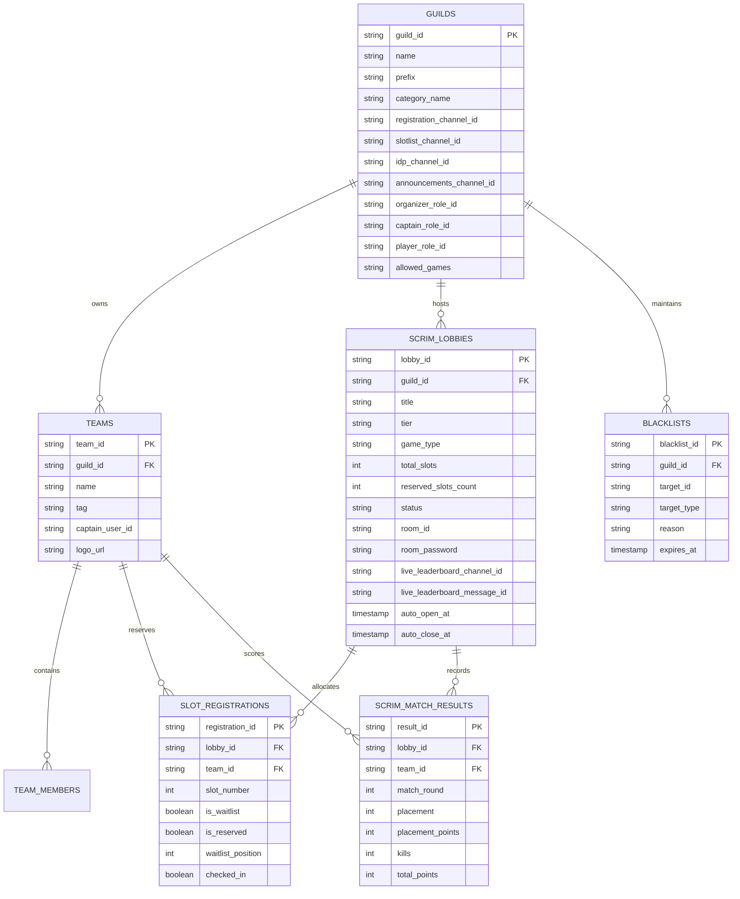

<div align="center">

# 💎 Crystal Scrims Manager

**Enterprise-Grade, Open-Source Discord Bot & Neo-Brutalist Web Dashboard for Esports Scrims, Brackets, and Tournament Management.**  
*Engineered to run 100% on free-tier cloud infrastructure with multi-database (Turso, SQLite, Supabase, Neon) support.*

Developed with ❤️ by **[Shuvransu Sekhar Sahoo](https://sahooshuvranshu.is-a.dev)** for **[Crystal Studio Labs](https://github.com/Crystal-Studio-Labs/)**.

[](https://sahooshuvranshu.is-a.dev)
[](https://github.com/Crystal-Studio-Labs/)
[](https://www.typescriptlang.org/)
[](https://discord.js.org/)
[](https://orm.drizzle.team/)
[](https://turso.tech/)
[](https://opensource.org/licenses/MIT)

</div>

---

## 📑 Table of Contents

- [⚡ Flagship Features](#-flagship-features)
- [🖥️ Cyber Neo-Brutalist Web Dashboard](#️-cyber-neo-brutalist-web-dashboard)
- [🏗️ Architecture & Database Schema](#️-architecture--database-schema)
- [📜 Complete 11-Command Suite Reference](#-complete-11-command-suite-reference)
- [🎮 Multi-Game Presets & Point Systems](#-multi-game-presets--point-systems)
- [🛡️ Anti-Misclick, Expiration & Security Safeguards](#️-anti-misclick-expiration--security-safeguards)
- [🚀 Quick Start (Local Development)](#-quick-start-local-development)
- [☁️ 100% Free-Tier Cloud Deployment Guide](#️-100-free-tier-cloud-deployment-guide)
  - [Render (Web Service + Uptime Keep-Alive)](#option-a-render-recommended-free)
  - [Fly.io (Global Edge Containers)](#option-b-flyio)
  - [Koyeb (Serverless MicroVMs)](#option-c-koyeb)
  - [Railway (Instant Deployment)](#option-d-railway)
  - [Docker / Self-Hosted VPS](#option-e-docker--self-hosted-vps)
  - [Turso Database Setup (Free 9GB LibSQL)](#option-f-turso-database-setup-free-9gb)
- [⚙️ Environment Variables Reference](#️-environment-variables-reference)
- [👨‍💻 Developer & Organization Credits](#-developer--organization-credits)
- [📄 License](#-license)

---

## ⚡ Flagship Features

* **🏎️ Ultra-Fast & Extremely Lightweight**:
  * Written in strict TypeScript with zero runtime bloat.
  * Consistently consumes **$<50\text{ MB}$ RAM**, fitting comfortably into free 256MB/512MB hosting containers.
* **✨ 1-Click Auto Structure & Role Provisioning (`/setup autostructure`)**:
  * Automatically creates the Discord Scrims category and permission-locked channels (`#📝・slot-registration`, `#📋・confirmed-slots`, `#🔑・room-credentials`, `#📢・announcements-results`) in **one click**.
  * Auto-provisions essential server roles: **`Scrim Organizer`** (Gold), **`Scrim Captain`** (Cyan), and **`Verified Player`** (Lime) with proper colors and hierarchy.
* **📊 Live Auto-Refreshing Discord Leaderboard Channel**:
  * When a scrim event starts or registrations open, the bot automatically provisions a dedicated channel (e.g. `📊・event-101-standings`) in the scrim category.
  * Pins an official standings embed that auto-refreshes in real-time whenever scores are added via `/points add` or the web API, plus a 60-second periodic background sync engine.
* **🎯 Configurable Game Whitelists (`/setup games`)**:
  * Server organizers can restrict scrim creation to specific games (e.g., only BGMI, only Valorant, or all supported games), preventing misconfigured lobbies.
* **🔑 Ephemeral Room IDP Security**:
  * Room ID & Password are delivered **ephemerally** to verified captains via the `[🔑 View Room IDP]` button. Unauthorized players or spectators can never view or leak room credentials.
* **🔄 Zero-Admin Auto-Promotion & Self-Service**:
  * Captains can click `[🚪 Leave Slot]` anytime; the engine immediately re-indexes confirmed slots and automatically promotes **Waitlist #1** into the confirmed roster.
  * Admins can kick no-shows via `/scrim kick`, instantly promoting the next waitlisted team.
* **🛡️ Concurrency-Safe Slot Rush & Misclick Defense**:
  * In-memory atomic mutexes prevent race conditions when dozens of teams click register simultaneously.
  * 1200ms per-user click debounce prevents double-submits.
  * All interactive menus and control panels feature **2 to 3-minute automatic collector timeouts**, safely disabling buttons to prevent stale clicks hours later.
* **🏆 Tournaments, Brackets & Export Tools**:
  * Full single-elimination tournament bracket generator (`/bracket generate`) with ASCII visualization and match winner reporting (`/bracket report`).
  * Team blacklists with expiration dates (`/advance blacklist`), roster lookups (`/advance roster`), audit logs (`/advance audit`), and CSV/JSON slot data export (`/advance export`).
* **📢 Formatted Pre-Defined Match Announcements**:
  * Broadcast stylish **WIN**, **LOSS**, and **DRAW** embeds with celebratory esports GIFs directly to your announcement channel (`/announce result`).
* **🌐 Industrial Neo-Brutalist Web Dashboard**:
  * Modern, cyber neo-brutalist standalone web portal with high-contrast borders, bold shadows, live event hub, team rosters, real-time leaderboard modal, and a Bearer-authenticated room manager.

---

## 🖥️ Cyber Neo-Brutalist Web Dashboard

Crystal Scrims Manager ships with a full-featured, responsive web dashboard built with **React**, **Vite**, **Tailwind CSS**, and **Lucide Icons**, styled in an **Industrial Neo-Brutalist Esports Theme**.

### Dashboard Pages & Modules:
1. **Landing Page (`#home`)**:
   - Hero header featuring live platform counters (Total Events, Active Teams, Live Matches, Avg Registration Time $<1.2\text{s}$).
   - System capability cards detailing Concurrency-Safe Rush, Ephemeral IDP, Real-Time Brackets, and Multi-DB compatibility.
   - Comprehensive interactive Discord Slash Command catalog.
2. **Events Hub (`#events`)**:
   - Filter events by status: **ALL**, **ONGOING (LIVE)**, **UPCOMING**, and **COMPLETED**.
   - Event summary cards showing game type, tier, confirmed slot counts, start times, and quick action buttons.
3. **Dedicated Event Roster & Leaderboard Modal (`#event-modal`)**:
   - Real-time slot breakdown displaying confirmed teams, captains, and waitlisted squads.
   - Interactive live points table sorted by Total Points, Placement Points, and Finish Kills with official tie-breaker rules.
4. **Admin Room & Credential Manager (`#admin`)**:
   - Direct web-based Room ID & Password management.
   - Constant-time `crypto.timingSafeEqual` Bearer token authentication against `ADMIN_API_SECRET`.
   - Real-time status indicators and quick-launch links to Discord.

```
+-------------------------------------------------------------------------+
| [💎 CRYSTAL SCRIMS MANAGER]       [Home]  [Events]  [Commands]  [Admin] |
+-------------------------------------------------------------------------+
|                                                                         |
|  ⚡ THE NEXT-GEN ESPORTS SCRIMS ENGINE                                  |
|  High-Velocity Tournament & Scrim Orchestration for Discord             |
|                                                                         |
|  +--------------------+  +--------------------+  +--------------------+ |
|  | TOTAL EVENTS: 42   |  | REGISTERED: 620    |  | LIVE LOBBIES: 3    | |
|  +--------------------+  +--------------------+  +--------------------+ |
|                                                                         |
|  [🔥 ONGOING EVENTS]                                                    |
|  +-------------------------------------------------------------------+  |
|  | #104 - BGMI Tier 1 Championship | 24/25 SLOTS | [VIEW LEADERBOARD] |  |
|  +-------------------------------------------------------------------+  |
+-------------------------------------------------------------------------+
```

---

## 🏗️ Architecture & Database Schema

The database is built on **Drizzle ORM** and is 100% agnostic across **Turso (LibSQL)**, **Local SQLite**, and **PostgreSQL (Supabase/Neon)**.



---

## 📜 Complete 11-Command Suite Reference

| Command | Subcommand | Description | Permissions |
| :--- | :--- | :--- | :--- |
| **`/setup`** | `autostructure` | **1-Click Magic**: Provisions Scrims category, 4 locked channels, and creates Organizer, Captain, & Player roles. | Admin / Organizer |
| | `wizard` | Interactive channel and role picker menus with 2-minute auto-disable collector. | Admin / Organizer |
| | `roles` | Dedicated 1-click role provisioning (`Scrim Organizer`, `Scrim Captain`, `Verified Player`). | Admin / Organizer |
| | `games` | Configure game whitelists (e.g. `ALL`, `BGMI`, `VALORANT`, `FREE_FIRE`, `CODM`, `APEX`). | Admin / Organizer |
| | `set-role` | Manually bind an existing server role as the Scrim Organizer role. | Admin / Organizer |
| **`/scrim`** | `create` | Provision a new lobby (game preset, slots, tier, scheduled open/close). Enforces game whitelist. | Admin / Organizer |
| | `open` | Open registrations; generates registration panel and creates/attaches the live leaderboard channel. | Admin / Organizer |
| | `panel` | Launch interactive Scrim Control Panel with Open, Close, IDP, and Slotlist buttons (3m timeout). | Admin / Organizer |
| | `close` | Immediately lock registrations for the active lobby. | Admin / Organizer |
| | `slotlist` | Display live confirmed teams & waitlist standings embed. | Admin / Organizer |
| | `reserve` | Pre-reserve a slot for an invited/VIP squad. | Admin / Organizer |
| | `kick` | Remove a no-show team (instantly promotes Waitlist #1). | Admin / Organizer |
| | `set-idp` | Store Room ID & Password for secure ephemeral distribution. | Admin / Organizer |
| | `cancel` | Cancel an active scrim lobby. | Admin / Organizer |
| **`/register`** | — | Register your team via slash command or click the **📝 Register Team** button on the lobby panel. | Everyone |
| **`/points`** | `add` | Record match placement and finish kills. Updates both Discord live channel and web API. | Admin / Organizer |
| | `table` | Display sorted Points Table embed with placement points, kills, and tie-breakers. | Everyone |
| | `reset` | Clear all scored rounds for a lobby. | Admin / Organizer |
| **`/announce`** | `result` | Broadcast pre-defined **WIN**, **LOSS**, or **DRAW** embeds with celebration GIFs to `#announcements`. | Admin / Organizer |
| **`/bracket`** | `generate` | Auto-generate single-elimination tournament bracket from confirmed teams with ASCII preview. | Admin / Organizer |
| | `report` | Report round match winner and automatically advance team to the next tournament round. | Admin / Organizer |
| | `view` | View the live status and standings of the active tournament bracket. | Everyone |
| **`/advance`** | `blacklist` | Ban abusive players/teams from entering scrims with custom reasons and expiration dates. | Admin / Organizer |
| | `roster` | Look up detailed team profiles, registered players, captains, and career stats. | Everyone |
| | `audit` | View chronological administrative audit logs for scrim actions. | Admin / Organizer |
| | `export` | Export lobby slot lists and team rosters as downloadable CSV or JSON payloads. | Admin / Organizer |
| **`/guide`** | — | Interactive step-by-step onboarding walkthrough for players and server managers. | Everyone |
| **`/help`** | — | Master interactive help center with `StringSelectMenu` categorizing all 11 command suites. | Everyone |
| **`/ping`** | — | Real-time bot latency, WebSocket heartbeat, system uptime, and RAM consumption. | Everyone |
| **`/tools`** | `calc` | Evaluate mathematical esports score expressions and tie-breakers. | Everyone |
| | `coinflip` | Provably fair heads or tails flip for map/side pick priority. | Everyone |
| | `roll` | Roll a random integer between a minimum and maximum range (e.g. 1 to 100). | Everyone |
| | `timer` | Set a countdown timer for scrim prep and check-in windows. | Everyone |

---

## 🎮 Multi-Game Presets & Point Systems

Crystal Scrims Manager includes built-in configurations for leading competitive titles:

| Game | Default Slots | Format | Scoring Preset |
| :--- | :---: | :---: | :--- |
| **BGMI / PUBG Mobile** | 25 | Squad (4v4 / BR) | Official BGIS/PMGC: 10-6-5-4-3-2-1-1 + 1 pt/kill |
| **Free Fire** | 12 | Squad (BR) | Official FFWS Standard: 12-9-8-7-6-5-4-3-2-1 + 1 pt/kill |
| **Valorant** | 2 | Custom (5v5) | Round Win/Loss + Combat Score differential |
| **Call of Duty: Mobile** | 25 | Squad (BR) | World Championship BR standard points |
| **Apex Legends** | 20 | Trios (BR) | ALGS Standard: 12-9-7-5-4-3-3-2-2-1-1-1-1-1-1 + 1 pt/kill |
| **Custom Esports** | 2–100 | Any | Custom configurable slot rules and point tables |

---

## 🛡️ Anti-Misclick, Expiration & Security Safeguards

1. **Per-User Click Debounce**:
   - An in-memory cooldown cache rejects rapid repeated clicks from the same user within 1200ms, completely eliminating duplicate registration requests and accidental double-clicks.
2. **Component Collector Timeouts**:
   - All interactive panels (e.g. `/scrim panel`, `/setup wizard`, `/help`) attach Discord `MessageComponentCollector` instances with an automatic 2-to-3 minute timeout.
   - Upon timeout, all buttons and select menus are gracefully disabled, preventing users from clicking stale components hours or days later.
3. **Constant-Time Bearer Authentication**:
   - The REST API enforces `crypto.timingSafeEqual` comparison against `ADMIN_API_SECRET` for all sensitive mutations, neutralizing timing attack vulnerabilities.
4. **Ephemeral Room IDP Delivery**:
   - Room credentials are delivered strictly through Discord ephemeral replies. Only confirmed team captains with appropriate guild permissions can view them.
5. **Role Hierarchy Checks**:
   - Organizer operations are gated behind database-stored role IDs and Discord administrator permissions, preventing unauthorized access.

---

## 🚀 Quick Start (Local Development)

### 1. Prerequisites
* **Node.js**: `v20.0.0` or higher
* Discord Application & Bot Token from the [Discord Developer Portal](https://discord.com/developers/applications).
* Bot Privileged Gateway Intents enabled: **Server Members Intent** and **Message Content Intent**.

### 2. Clone and Install
```bash
git clone https://github.com/Crystal-Studio-Labs/Crystal-Scrims-Manager.git
cd Crystal-Scrims-Manager
npm install
npm --prefix dashboard install
```

### 3. Environment Configuration
Copy `.env.example` to `.env`:
```bash
cp .env.example .env
```
Fill in your credentials:
```env
DISCORD_TOKEN=your_bot_token_here
DISCORD_CLIENT_ID=your_application_client_id_here
DISCORD_DEV_GUILD_ID=your_testing_server_id_here
DB_DRIVER=sqlite
DB_SQLITE_PATH=local.db
PORT=8080
ADMIN_API_SECRET=your_super_secret_bearer_token_here
DEFAULT_ORGANIZER_ROLE=Scrim Organizer
```

### 4. Push Database Schema
```bash
npm run db:push
```

### 5. Deploy Slash Commands
```bash
npm run deploy:commands
```

### 6. Run Bot & Dashboard
```bash
# Terminal 1: Run Discord Bot & API (hot reload)
npm run dev

# Terminal 2: Run Brutalist Web Dashboard
npm --prefix dashboard run dev
```

Visit `http://localhost:5173` to explore the Web Dashboard and test your bot commands in your Discord server!

---

## ☁️ 100% Free-Tier Cloud Deployment Guide

Crystal Scrims Manager is fully configured with multi-cloud infrastructure manifests so you can deploy it **100% free of charge**.

### Option A: Render (Recommended Free)
1. Push your repository to GitHub.
2. Log into [Render](https://render.com) and click **New Web Service**.
3. Link your repository. Render will automatically detect [`render.yaml`](render.yaml).
4. Configure Environment Variables:
   - `DISCORD_TOKEN`: Your Discord Bot Token.
   - `DISCORD_CLIENT_ID`: Your Discord Client ID.
   - `DB_DRIVER`: `turso`
   - `TURSO_DATABASE_URL`: `libsql://your-db.turso.io`
   - `TURSO_AUTH_TOKEN`: Your Turso auth token.
   - `ADMIN_API_SECRET`: A secure random password.
5. **24/7 Keep-Alive Setup**:
   - Register a free account on [UptimeRobot](https://uptimerobot.com/) or [cron-job.org](https://cron-job.org/).
   - Add an HTTP monitor pinging: `https://your-app.onrender.com/health` every **10 minutes**.
   - *Your bot stays awake 24/7 with zero cost!*

### Option B: Fly.io
The repository includes a ready-to-use [`fly.toml`](fly.toml):
```bash
# Install flyctl
curl -L https://fly.io/install.sh | sh

# Launch application
fly launch --no-deploy
fly secrets set DISCORD_TOKEN="your_token" DISCORD_CLIENT_ID="your_client_id" DB_DRIVER="turso" TURSO_DATABASE_URL="libsql://..." TURSO_AUTH_TOKEN="..." ADMIN_API_SECRET="..."
fly deploy
```

### Option C: Koyeb
The repository includes a configured [`koyeb.yaml`](koyeb.yaml):
1. Sign up on [Koyeb](https://www.koyeb.com).
2. Connect your GitHub repository.
3. Import `koyeb.yaml` or set build command `npm run build && npm --prefix dashboard run build` and run command `npm start`.
4. Add environment secrets.

### Option D: Railway
The repository includes a configured [`railway.toml`](railway.toml):
1. Create a new project on [Railway](https://railway.app).
2. Select **Deploy from GitHub repo**.
3. Add environment variables in the Railway dashboard.

### Option E: Docker / Self-Hosted VPS
The repository includes production-optimized [`Dockerfile`](Dockerfile) and [`docker-compose.yml`](docker-compose.yml):
```bash
# Build and run in detached mode
docker compose up -d --build

# View real-time logs
docker compose logs -f
```

### Option F: Turso Database Setup (Free 9GB)
Turso provides 9GB of free storage and 1 Billion reads per month on LibSQL:
```bash
# Install Turso CLI
curl -sSfL https://get.tur.so/install.sh | bash

# Create database
turso db create crystal-scrims

# Get connection details
turso db show crystal-scrims --url
turso db tokens create crystal-scrims
```
Copy the URL (`libsql://...`) and token into your `.env` as `TURSO_DATABASE_URL` and `TURSO_AUTH_TOKEN`.

---

## ⚙️ Environment Variables Reference

| Variable | Required | Default | Description |
| :--- | :---: | :---: | :--- |
| `DISCORD_TOKEN` | **Yes** | — | Discord Bot Token from Discord Developer Portal. |
| `DISCORD_CLIENT_ID` | **Yes** | — | Discord Application ID. |
| `DISCORD_DEV_GUILD_ID` | No | — | Guild ID for instant slash command registration during development. |
| `DB_DRIVER` | No | `sqlite` | Database driver: `sqlite`, `turso`, or `postgres`. |
| `DB_SQLITE_PATH` | No | `local.db` | Local SQLite database file path. |
| `TURSO_DATABASE_URL` | If Turso | — | LibSQL connection URL (`libsql://...`). |
| `TURSO_AUTH_TOKEN` | If Turso | — | LibSQL authentication token. |
| `PORT` | No | `8080` | Port for the HTTP health server, dashboard, and REST API. |
| `ADMIN_API_SECRET` | No | `crystal_admin_dev_secret_2026` | Bearer token secret protecting `/api/scrims/*` endpoints. |
| `DEFAULT_ORGANIZER_ROLE`| No | `Scrim Organizer` | Default role name assigned Scrim Organizer permissions. |

---

## 👨‍💻 Developer & Organization Credits

* **Lead Architect & Developer**: **[Shuvransu Sekhar Sahoo](https://sahooshuvranshu.is-a.dev)**
* **Organization**: **[Crystal Studio Labs](https://github.com/Crystal-Studio-Labs/)**
* **Repository**: [https://github.com/Crystal-Studio-Labs/Crystal-Scrims-Manager](https://github.com/Crystal-Studio-Labs/Crystal-Scrims-Manager)
* **Website**: [https://sahooshuvranshu.is-a.dev](https://sahooshuvranshu.is-a.dev)

---

## 📄 License

This project is licensed under the **MIT License** — see the [`LICENSE`](LICENSE) file for details.  
Free for personal, community, and commercial esports tournament use.

<div align="center">
  <sub>Built with 💎 precision by Crystal Studio Labs.</sub>
</div>
