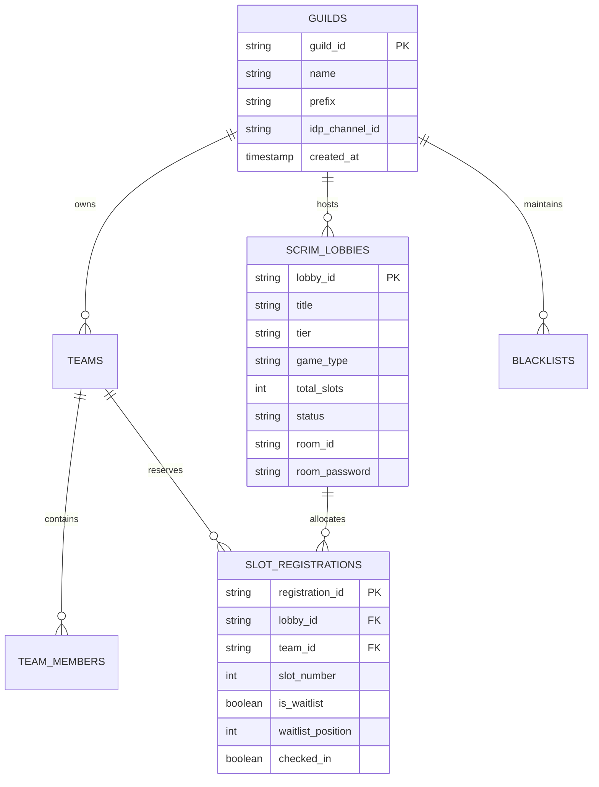

<div align="center">

# 💎 Crystal Scrims Manager

**Enterprise-grade, open-source Discord bot for esports scrims, brackets, and tournament management.**  
*Engineered to run 100% on free-tier cloud infrastructure with multi-database support (Turso, SQLite, Supabase, Neon).*

[](https://www.typescriptlang.org/)
[](https://discord.js.org/)
[](https://orm.drizzle.team/)
[](https://turso.tech/)
[](https://render.com)
[](https://www.docker.com/)
[](https://opensource.org/licenses/MIT)

</div>

---

## ⚡ Highlights

* **🏎️ Ultra-Fast & Lightweight**: Built with modern TypeScript and clean layered architecture. Runs smoothly on $<60\text{ MB}$ RAM, comfortably fitting into free 256MB/512MB hosting limits.
* **🛡️ Zero Race Conditions**: Concurrency-safe slot allocation engine handles high-intensity registration drops (BGMI, PUBG Mobile, Free Fire) without overbooking.
* **✨ Modern Discord UI Components**: Full support for interactive **Discord Modals**, **Buttons**, and **Ephemeral Menus** for effortless player registrations.
* **🔌 Pluggable Multi-Database**:
  * **Turso (LibSQL)**: 9GB storage, 1 Billion reads/month, zero sleep.
  * **Local SQLite (`local.db`)**: Instant zero-setup local development right out of the box.
  * **Supabase / Neon (PostgreSQL)**: Full relational SQL engine.
* **🌐 Universal Free Hosting Ready**: Ships with native HTTP `/health` keep-alive server for **Render** (750 free hrs/mo 24/7 uptime via UptimeRobot), **Koyeb**, **Fly.io**, or **Docker Compose**.
* **🎮 Universal Game Support**:
  * **Battle Royale**: BGMI, PUBG Mobile, Free Fire, Apex Legends (Slots 1–25, waitlist, check-in, Room ID/Pass vault, points table).
  * **Tactical 5v5**: Valorant, CS2, Rocket League (Single/Double elimination brackets, map veto, match channels).

---

## 🏗️ Architecture & Database Schema



---

## 🚀 Quick Start (Local Development)

### 1. Prerequisites
* **Node.js**: `v20.0.0` or higher
* A Discord Bot Token from the [Discord Developer Portal](https://discord.com/developers/applications).

### 2. Clone and Install
```bash
git clone https://github.com/your-username/crystal-scrims-manager.git
cd crystal-scrims-manager
npm install
```

### 3. Environment Configuration
Copy `.env.example` to `.env`:
```bash
cp .env.example .env
```
Fill in your credentials:
```env
DISCORD_TOKEN=your_bot_token_here
DISCORD_CLIENT_ID=your_application_client_id_here
DB_DRIVER=sqlite
DB_SQLITE_PATH=local.db
PORT=8080
```

### 4. Push Database Schema
```bash
npm run db:push
```

### 5. Deploy Slash Commands
```bash
npm run deploy:commands
```

### 6. Run the Bot
```bash
# Development (with auto-reload)
npm run dev

# Production build
npm run build
npm start
```

---

## ☁️ 100% Free Cloud Deployment Guide

### Option A: Render (Free Web Service 24/7)
1. Push your repository to GitHub.
2. Log into [Render](https://render.com) and click **New Web Service**.
3. Select your repository. Render will automatically detect `render.yaml`.
4. Add your environment variables:
   * `DISCORD_TOKEN`: Your Discord Bot Token.
   * `DISCORD_CLIENT_ID`: Your Application ID.
   * `DB_DRIVER`: `turso` (or `sqlite` with Render disk).
   * `TURSO_DATABASE_URL`: Your LibSQL connection URL.
   * `TURSO_AUTH_TOKEN`: Your Turso auth token.
5. **Keep-Alive Setup**:
   * Render free services sleep after 15 minutes of inactivity.
   * Create a free account on [UptimeRobot](https://uptimerobot.com/) or [cron-job.org](https://cron-job.org/).
   * Add an HTTP monitor pinging: `https://your-bot-name.onrender.com/health` every **10 minutes**.
   * *Your bot will now stay awake 24/7 without costing a penny!*

### Option B: Docker / VPS Self-Hosting
```bash
docker compose up -d
```

---

## 📜 Slash Commands Reference

| Command | Subcommand | Description | Permission |
| :--- | :--- | :--- | :--- |
| `/ping` | — | Display bot latency, API heartbeat, and RAM usage | Everyone |
| `/scrim` | `create` | Provision a new scrim lobby (title, slots, tier, game) | Manage Guild |
| `/scrim` | `open` | Open registrations with interactive **Register** & **Slotlist** buttons | Manage Guild |
| `/scrim` | `close` | Lock registrations for the lobby | Manage Guild |
| `/scrim` | `slotlist` | Display live confirmed teams & waitlist queue | Manage Guild |
| `/scrim` | `set-idp` | Securely store Room ID & Password for the match | Manage Guild |
| `/register` | — | Register team via command or click the **📝 Register Team** button | Everyone |

---

## 🤝 Contributing

Contributions are welcome! Please feel free to submit a Pull Request.

1. Fork the Project
2. Create your Feature Branch (`git checkout -b feature/AmazingFeature`)
3. Commit your Changes (`git commit -m 'Add some AmazingFeature'`)
4. Push to the Branch (`git push origin feature/AmazingFeature`)
5. Open a Pull Request

---

## 📄 License

Distributed under the **MIT License**. See [`LICENSE`](LICENSE) for more information.
