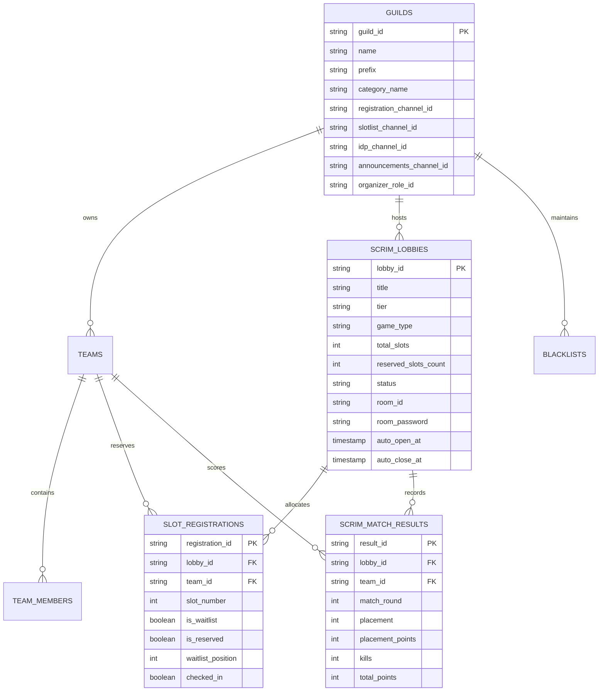

<div align="center">

# 💎 Crystal Scrims Manager

**Enterprise-grade, open-source Discord bot for esports scrims, brackets, and tournament management.**  
*Developed by [Shuvransu Sekhar Sahoo](https://sahooshuvranshu.is-a.dev) for [Crystal Studio Labs](https://github.com/Crystal-Studio-Labs/).*  
*Engineered to run 100% on free-tier cloud infrastructure with multi-database support (Turso, SQLite, Supabase, Neon).*

[](https://sahooshuvranshu.is-a.dev)
[](https://github.com/Crystal-Studio-Labs/)
[](https://www.typescriptlang.org/)
[](https://discord.js.org/)
[](https://orm.drizzle.team/)
[](https://turso.tech/)
[](https://render.com)
[](https://www.docker.com/)
[](https://opensource.org/licenses/MIT)

</div>

---

## ⚡ Flagship Features

* **🏎️ Ultra-Fast & Lightweight**: Built with strict TypeScript and clean layered architecture. Runs smoothly on $<50\text{ MB}$ RAM, comfortably fitting into free 256MB/512MB hosting limits.
* **✨ Modern Discord UI Components**: Full adoption of native **Discord Modals**, **`StringSelectMenuBuilder`**, **`ChannelSelectMenuBuilder`**, **`RoleSelectMenuBuilder`**, and **Action Row Buttons**.
* **🚀 1-Click Auto Structure Generator (`/setup autostructure`)**:
  * Automatically creates the entire Scrims category with properly permissioned channels (`#📝・slot-registration`, `#📋・confirmed-slots`, `#🔑・room-credentials`, `#📢・announcements-results`) in **one command**.
* **🔑 Ephemeral Room IDP Security**:
  * Room ID & Password are delivered **ephemerally** to verified captains via the `[🔑 View Room IDP]` button, completely preventing credential leaks to unregistered players.
* **🔄 Zero-Admin Auto-Promotion & Self-Service**:
  * Team captains can click `[🚪 Leave Slot]`; the engine automatically shifts the confirmed slots and promotes **Waitlist #1** instantly.
  * Admins can kick no-shows via `/scrim kick`, which automatically promotes the next waitlist squad.
* **📢 Pre-Defined Match Announcements**:
  * Broadcast formatted **WIN**, **LOSS**, and **DRAW** outcome embeds with celebratory GIFs/images directly to `#announcements`.
* **📊 Native Points Table & Leaderboard**:
  * Records match placements and finish kills, calculating total scores using official BGIS/PMGC standard rules (10-6-5-4-3-2-1-1) with tie-breaker sorting.
* **⏰ Automated Recurring Scrim Scheduler**:
  * Background cron engine checks every minute to automatically open and close registrations at pre-scheduled times.
* **🎮 Multi-Game Presets**:
  * Native rules for **BGMI / PUBG Mobile** (Squad 25), **Free Fire** (Squad 12), **Valorant** (Custom 5v5), **CODM** (BR 25), **Apex Legends** (Trios 20), and **Custom Games** (2 to 100 slots).
* **🔌 Pluggable Multi-Database**:
  * **Turso (LibSQL)**: 9GB storage, 1 Billion reads/month, zero sleep.
  * **Local SQLite (`local.db`)**: Instant zero-setup local development right out of the box.
  * **Supabase / Neon (PostgreSQL)**: Full relational SQL engine.
* **🌐 Universal Free Hosting Ready**: Ships with native HTTP `/health` keep-alive server for **Render** (750 free hrs/mo 24/7 uptime via UptimeRobot), **Koyeb**, **Fly.io**, or **Docker Compose**.

---

## 🏗️ Architecture & Database Schema



---

## 🚀 Quick Start (Local Development)

### 1. Prerequisites
* **Node.js**: `v20.0.0` or higher
* A Discord Bot Token from the [Discord Developer Portal](https://discord.com/developers/applications).

### 2. Clone and Install
```bash
git clone https://github.com/your-username/crystal-scrims-manager.git
cd crystal-scrims-manager
npm install
```

### 3. Environment Configuration
Copy `.env.example` to `.env`:
```bash
cp .env.example .env
```
Fill in your credentials:
```env
DISCORD_TOKEN=your_bot_token_here
DISCORD_CLIENT_ID=your_application_client_id_here
DISCORD_DEV_GUILD_ID=your_testing_server_id_here
DB_DRIVER=sqlite
DB_SQLITE_PATH=local.db
PORT=8080
DEFAULT_ORGANIZER_ROLE=Scrim Organizer
```

### 4. Push Database Schema
```bash
npm run db:push
```

### 5. Deploy Slash Commands
```bash
npm run deploy:commands
```

### 6. Run the Bot
```bash
# Development (with auto-reload)
npm run dev

# Production build
npm run build
npm start
```

---

## ☁️ 100% Free Cloud Deployment Guide

### Option A: Render (Free Web Service 24/7)
1. Push your repository to GitHub.
2. Log into [Render](https://render.com) and click **New Web Service**.
3. Select your repository. Render will automatically detect `render.yaml`.
4. Add your environment variables:
   * `DISCORD_TOKEN`: Your Discord Bot Token.
   * `DISCORD_CLIENT_ID`: Your Application ID.
   * `DB_DRIVER`: `turso` (or `sqlite` with Render persistent disk).
   * `TURSO_DATABASE_URL`: Your LibSQL connection URL.
   * `TURSO_AUTH_TOKEN`: Your Turso auth token.
5. **Keep-Alive Setup**:
   * Create a free account on [UptimeRobot](https://uptimerobot.com/) or [cron-job.org](https://cron-job.org/).
   * Add an HTTP monitor pinging: `https://your-bot-name.onrender.com/health` every **10 minutes**.
   * *Your bot will stay awake 24/7 for $0!*

### Option B: Docker / VPS Self-Hosting
```bash
docker compose up -d
```

---

## 📜 Complete Slash Commands Reference

| Command | Subcommand | Description | Permissions |
| :--- | :--- | :--- | :--- |
| `/help` | — | Interactive master help center with `StringSelectMenu` categories | Everyone |
| `/ping` | — | Real-time latency, WebSocket heartbeat, uptime, and RAM usage | Everyone |
| `/setup` | `autostructure` | **1-Click Magic**: Automatically spawns category and all scrim channels | Admin / Organizer |
| `/setup` | `wizard` | Interactive channel and role picker menus to link existing channels | Admin / Organizer |
| `/setup` | `set-role` | Designate the Scrim Organizer / Event Manager staff role | Admin / Organizer |
| `/scrim` | `create` | Provision a new lobby (game preset, slots, tier) | Admin / Organizer |
| `/scrim` | `open` | Open registrations with interactive **Register**, **IDP**, & **Slotlist** buttons | Admin / Organizer |
| `/scrim` | `panel` | Launch the Admin Control Panel dashboard with quick action buttons | Admin / Organizer |
| `/scrim` | `close` | Lock registrations for the lobby | Admin / Organizer |
| `/scrim` | `slotlist` | Display live confirmed teams & waitlist standings | Admin / Organizer |
| `/scrim` | `reserve` | Pre-reserve a slot for an invited/VIP squad | Admin / Organizer |
| `/scrim` | `kick` | Remove a no-show team (auto-promotes Waitlist #1) | Admin / Organizer |
| `/scrim` | `set-idp` | Store Room ID & Password for secure distribution | Admin / Organizer |
| `/scrim` | `cancel` | Cancel an active scrim lobby | Admin / Organizer |
| `/register` | — | Register team via command or click the **📝 Register Team** button | Everyone |
| `/announce` | `result` | Broadcast pre-defined Win, Loss, or Draw embeds with celebration GIFs | Admin / Organizer |
| `/points` | `add` | Record match placement and finish kills for a team | Admin / Organizer |
| `/points` | `table` | Display the sorted live Points Table standings | Everyone |
| `/points` | `reset` | Clear all scores for a lobby | Admin / Organizer |

---

## 👨‍💻 Developer & Organization

* **Lead Architect & Developer**: **[Shuvransu Sekhar Sahoo](https://sahooshuvranshu.is-a.dev)**
* **Organization**: **[Crystal Studio Labs](https://github.com/Crystal-Studio-Labs/)**
* **Repository**: [https://github.com/Crystal-Studio-Labs/Crystal-Scrims-Manager](https://github.com/Crystal-Studio-Labs/Crystal-Scrims-Manager)

---

## 📄 License

Distributed under the **MIT License**. See [`LICENSE`](LICENSE) for more information.
