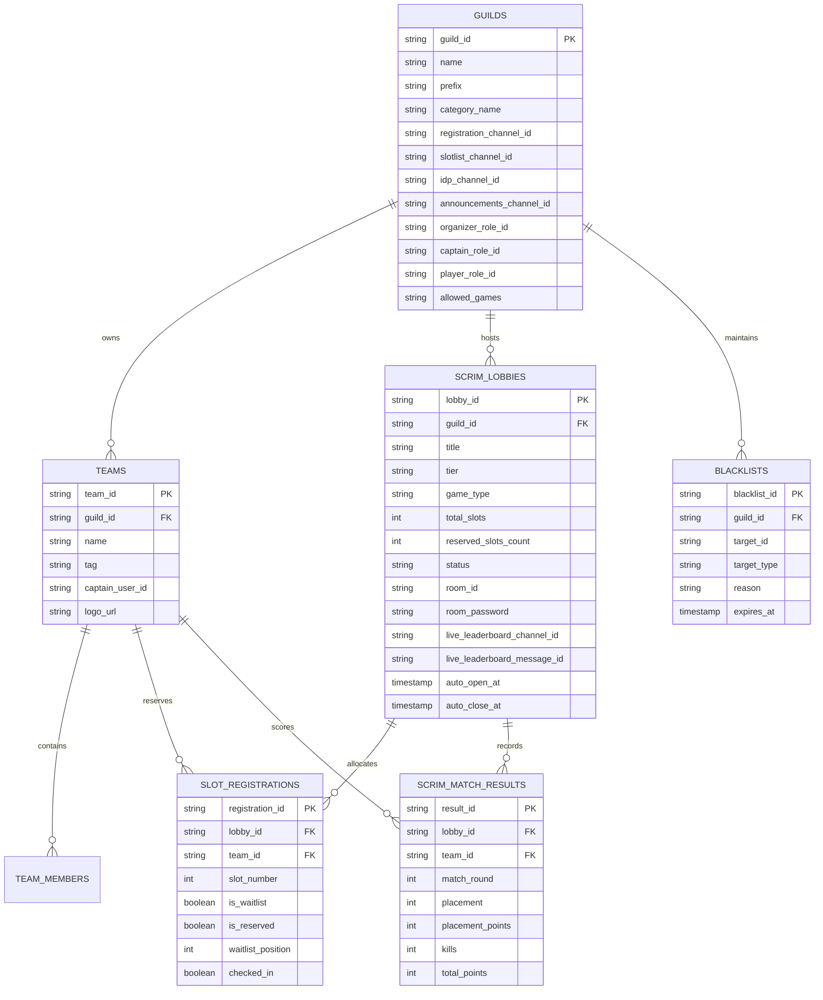

<div align="center">

# 💎 Crystal Scrims Manager

**Enterprise-Grade, Open-Source Discord Bot & Neo-Brutalist Web Dashboard for Esports Scrims, Brackets, and Tournament Management.**  
*Engineered to run 100% on free-tier cloud infrastructure with multi-database (Turso, SQLite, Supabase, Neon) support.*

Developed with ❤️ by **[Shuvransu Sekhar Sahoo](https://sahooshuvranshu.is-a.dev)** for **[Crystal Studio Labs](https://github.com/Crystal-Studio-Labs/)**.

[](https://sahooshuvranshu.is-a.dev)
[](https://github.com/Crystal-Studio-Labs/)
[](https://www.typescriptlang.org/)
[](https://discord.js.org/)
[](https://orm.drizzle.team/)
[](https://turso.tech/)
[](https://opensource.org/licenses/MIT)

</div>

---

## 📑 Table of Contents

- [⚡ Flagship Features](#-flagship-features)
- [🖥️ Cyber Neo-Brutalist Web Dashboard](#️-cyber-neo-brutalist-web-dashboard)
- [🏗️ Architecture & Database Schema](#️-architecture--database-schema)
- [📜 Complete 11-Command Suite Reference](#-complete-11-command-suite-reference)
- [🎮 Multi-Game Presets & Point Systems](#-multi-game-presets--point-systems)
- [🛡️ Anti-Misclick, Expiration & Security Safeguards](#️-anti-misclick-expiration--security-safeguards)
- [🚀 Quick Start (Local Development)](#-quick-start-local-development)
- [☁️ Cloud Hosting & Deployment Guide](#️-cloud-hosting--deployment-guide)
  - [Architectural Decision Matrix](#️-architectural-decision-matrix-which-option-should-you-choose)
  - [Option 1: Hybrid (All-In-One Monolith) — RECOMMENDED](#-option-1-hybrid-all-in-one-monolith--recommended-100-free)
  - [Option 2: Decoupled Multi-Tier Stack (Frontend + Backend + Cloud DB)](#-option-2-decoupled-multi-tier-stack-frontend--backend--cloud-db)
  - [Option 3: Docker & Self-Hosted VPS Deployment](#-option-3-docker--self-hosted-vps-deployment)
- [⚙️ Environment Variables Reference](#️-environment-variables-reference)
- [👨‍💻 Developer & Organization Credits](#-developer--organization-credits)
- [📄 License](#-license)

---

## ⚡ Flagship Features

* **🏎️ Ultra-Fast & Extremely Lightweight**:
  * Written in strict TypeScript with zero runtime bloat.
  * Consistently consumes **$<50\text{ MB}$ RAM**, fitting comfortably into free 256MB/512MB hosting containers.
* **✨ 1-Click Auto Structure & Role Provisioning (`/setup autostructure`)**:
  * Automatically creates the Discord Scrims category and permission-locked channels (`#📝・slot-registration`, `#📋・confirmed-slots`, `#🔑・room-credentials`, `#📢・announcements-results`) in **one click**.
  * Auto-provisions essential server roles: **`Scrim Organizer`** (Gold), **`Scrim Captain`** (Cyan), and **`Verified Player`** (Lime) with proper colors and hierarchy.
* **📊 Live Auto-Refreshing Discord Leaderboard Channel**:
  * When a scrim event starts or registrations open, the bot automatically provisions a dedicated channel (e.g. `📊・event-101-standings`) in the scrim category.
  * Pins an official standings embed that auto-refreshes in real-time whenever scores are added via `/points add` or the web API, plus a 60-second periodic background sync engine.
* **🎯 Configurable Game Whitelists (`/setup games`)**:
  * Server organizers can restrict scrim creation to specific games (e.g., only BGMI, only Valorant, or all supported games), preventing misconfigured lobbies.
* **🔑 Ephemeral Room IDP Security**:
  * Room ID & Password are delivered **ephemerally** to verified captains via the `[🔑 View Room IDP]` button. Unauthorized players or spectators can never view or leak room credentials.
* **🔄 Zero-Admin Auto-Promotion & Self-Service**:
  * Captains can click `[🚪 Leave Slot]` anytime; the engine immediately re-indexes confirmed slots and automatically promotes **Waitlist #1** into the confirmed roster.
  * Admins can kick no-shows via `/scrim kick`, instantly promoting the next waitlisted team.
* **🛡️ Concurrency-Safe Slot Rush & Misclick Defense**:
  * In-memory atomic mutexes prevent race conditions when dozens of teams click register simultaneously.
  * 1200ms per-user click debounce prevents double-submits.
  * All interactive menus and control panels feature **2 to 3-minute automatic collector timeouts**, safely disabling buttons to prevent stale clicks hours later.
* **🏆 Tournaments, Brackets & Export Tools**:
  * Full single-elimination tournament bracket generator (`/bracket generate`) with ASCII visualization and match winner reporting (`/bracket report`).
  * Team blacklists with expiration dates (`/advance blacklist`), roster lookups (`/advance roster`), audit logs (`/advance audit`), and CSV/JSON slot data export (`/advance export`).
* **📢 Formatted Pre-Defined Match Announcements**:
  * Broadcast stylish **WIN**, **LOSS**, and **DRAW** embeds with celebratory esports GIFs directly to your announcement channel (`/announce result`).
* **🌐 Industrial Neo-Brutalist Web Dashboard**:
  * Modern, cyber neo-brutalist standalone web portal with high-contrast borders, bold shadows, live event hub, team rosters, real-time leaderboard modal, and a Bearer-authenticated room manager.

---

## 🖥️ Cyber Neo-Brutalist Web Dashboard

Crystal Scrims Manager ships with a full-featured, responsive web dashboard built with **React**, **Vite**, **Tailwind CSS**, and **Lucide Icons**, styled in an **Industrial Neo-Brutalist Esports Theme**.

### Web Portal Modules & Capabilities:
1. **Multi-Server Customization & Switcher**:
   - Community-aware architecture: select any connected Discord server from the header dropdown to view server-specific scrims, custom prefix, and allowed game modes.
   - Deep-linking support via `?guild=GUILD_ID` for sharing direct community tournament links.
2. **Ultra-Dark Obsidian & Brutalist Light Theme Support**:
   - 1-click theme switcher in header (Sun/Moon) with preferences saved in `localStorage`.
   - Dark theme: deep pitch obsidian (`#050507`), carbon surfaces (`#0D0F16`), sharp contrast borders, glowing cyber neon accents (`#00F0FF`, `#39FF14`, `#FFDF00`, `#FF0055`).
   - Light theme: stark industrial brutalist canvas (`#F4F4F0`), pure white cards (`#FFFFFF`), solid 2px black borders, heavy black shadows.
3. **Landing & Events Hub (`#landing` & `#events`)**:
   - Real-time platform counters (Total Events, Active Matches, Connected Servers, Sub-second Concurrency).
   - Filter events by status: **ALL**, **LIVE / ONGOING**, **UPCOMING**, and **COMPLETED**.
   - Filter by esports discipline: **BGMI**, **Free Fire**, **Valorant**, **CODM**, **Apex Legends**.
4. **Dedicated Event Standings & Rosters (`#event-detail`)**:
   - **Live Standings**: Rank `#1` to `#25`, placement points, finish kills, total score, and official tie-breakers.
   - **Confirmed Rosters**: Slot list, captain user IDs, and real-time check-in badges.
   - **Waitlist Queue**: Real-time position tracking for auto-promoted squads.
   - **Scoring Rules Matrix**: BGIS / PMGC / FFWS point systems.
   - *100% focused on players and spectators — zero administrative clutter (all staff actions are executed securely via Discord slash commands).*

```
+-----------------------------------------------------------------------------------+
| [💎 CRYSTAL SCRIMS]   [Server: All Servers ▼]   [Overview] [Events] [Standings] ☀️ |
+-----------------------------------------------------------------------------------+
|                                                                                   |
|  ⚡ THE NEXT-GEN ESPORTS SCRIMS ENGINE                                            |
|  High-Velocity Tournament & Scrim Operations Portal                               |
|                                                                                   |
|  +--------------------+  +--------------------+  +--------------------+           |
|  | TOTAL EVENTS: 42   |  | REGISTERED: 620    |  | LIVE LOBBIES: 3    |           |
|  +--------------------+  +--------------------+  +--------------------+           |
|                                                                                   |
|  [🔥 ONGOING EVENTS]                                                              |
|  +-----------------------------------------------------------------------------+  |
|  | #104 - BGMI Tier 1 Championship | 24/25 SLOTS | [VIEW LIVE STANDINGS]       |  |
|  +-----------------------------------------------------------------------------+  |
+-----------------------------------------------------------------------------------+
```

---

## 🏗️ Architecture & Database Schema

The database is built on **Drizzle ORM** and is 100% agnostic across **Turso (LibSQL)**, **Local SQLite**, and **PostgreSQL (Supabase/Neon)**.



---

## 📜 Complete 11-Command Suite Reference

| Command | Subcommand | Description | Permissions |
| :--- | :--- | :--- | :--- |
| **`/setup`** | `autostructure` | **1-Click Magic**: Provisions Scrims category, 4 locked channels, and creates Organizer, Captain, & Player roles. | Admin / Organizer |
| | `wizard` | Interactive channel and role picker menus with 2-minute auto-disable collector. | Admin / Organizer |
| | `roles` | Dedicated 1-click role provisioning (`Scrim Organizer`, `Scrim Captain`, `Verified Player`). | Admin / Organizer |
| | `games` | Configure game whitelists (e.g. `ALL`, `BGMI`, `VALORANT`, `FREE_FIRE`, `CODM`, `APEX`). | Admin / Organizer |
| | `set-role` | Manually bind an existing server role as the Scrim Organizer role. | Admin / Organizer |
| **`/scrim`** | `create` | Provision a new lobby (game preset, slots, tier, scheduled open/close). Enforces game whitelist. | Admin / Organizer |
| | `open` | Open registrations; generates registration panel and creates/attaches the live leaderboard channel. | Admin / Organizer |
| | `panel` | Launch interactive Scrim Control Panel with Open, Close, IDP, and Slotlist buttons (3m timeout). | Admin / Organizer |
| | `close` | Immediately lock registrations for the active lobby. | Admin / Organizer |
| | `slotlist` | Display live confirmed teams & waitlist standings embed. | Admin / Organizer |
| | `reserve` | Pre-reserve a slot for an invited/VIP squad. | Admin / Organizer |
| | `kick` | Remove a no-show team (instantly promotes Waitlist #1). | Admin / Organizer |
| | `set-idp` | Store Room ID & Password for secure ephemeral distribution. | Admin / Organizer |
| | `cancel` | Cancel an active scrim lobby. | Admin / Organizer |
| **`/register`** | — | Register your team via slash command or click the **📝 Register Team** button on the lobby panel. | Everyone |
| **`/points`** | `add` | Record match placement and finish kills. Updates both Discord live channel and web API. | Admin / Organizer |
| | `table` | Display sorted Points Table embed with placement points, kills, and tie-breakers. | Everyone |
| | `reset` | Clear all scored rounds for a lobby. | Admin / Organizer |
| **`/announce`** | `result` | Broadcast pre-defined **WIN**, **LOSS**, or **DRAW** embeds with celebration GIFs to `#announcements`. | Admin / Organizer |
| **`/bracket`** | `generate` | Auto-generate single-elimination tournament bracket from confirmed teams with ASCII preview. | Admin / Organizer |
| | `report` | Report round match winner and automatically advance team to the next tournament round. | Admin / Organizer |
| | `view` | View the live status and standings of the active tournament bracket. | Everyone |
| **`/advance`** | `blacklist` | Ban abusive players/teams from entering scrims with custom reasons and expiration dates. | Admin / Organizer |
| | `roster` | Look up detailed team profiles, registered players, captains, and career stats. | Everyone |
| | `audit` | View chronological administrative audit logs for scrim actions. | Admin / Organizer |
| | `export` | Export lobby slot lists and team rosters as downloadable CSV or JSON payloads. | Admin / Organizer |
| **`/guide`** | — | Interactive step-by-step onboarding walkthrough for players and server managers. | Everyone |
| **`/help`** | — | Master interactive help center with `StringSelectMenu` categorizing all 11 command suites. | Everyone |
| **`/ping`** | — | Real-time bot latency, WebSocket heartbeat, system uptime, and RAM consumption. | Everyone |
| **`/tools`** | `calc` | Evaluate mathematical esports score expressions and tie-breakers. | Everyone |
| | `coinflip` | Provably fair heads or tails flip for map/side pick priority. | Everyone |
| | `roll` | Roll a random integer between a minimum and maximum range (e.g. 1 to 100). | Everyone |
| | `timer` | Set a countdown timer for scrim prep and check-in windows. | Everyone |

---

## 🎮 Multi-Game Presets & Point Systems

Crystal Scrims Manager includes built-in configurations for leading competitive titles:

| Game | Default Slots | Format | Scoring Preset |
| :--- | :---: | :---: | :--- |
| **BGMI / PUBG Mobile** | 25 | Squad (4v4 / BR) | Official BGIS/PMGC: 10-6-5-4-3-2-1-1 + 1 pt/kill |
| **Free Fire** | 12 | Squad (BR) | Official FFWS Standard: 12-9-8-7-6-5-4-3-2-1 + 1 pt/kill |
| **Valorant** | 2 | Custom (5v5) | Round Win/Loss + Combat Score differential |
| **Call of Duty: Mobile** | 25 | Squad (BR) | World Championship BR standard points |
| **Apex Legends** | 20 | Trios (BR) | ALGS Standard: 12-9-7-5-4-3-3-2-2-1-1-1-1-1-1 + 1 pt/kill |
| **Custom Esports** | 2–100 | Any | Custom configurable slot rules and point tables |

---

## 🛡️ Anti-Misclick, Expiration & Security Safeguards

1. **Per-User Click Debounce**:
   - An in-memory cooldown cache rejects rapid repeated clicks from the same user within 1200ms, completely eliminating duplicate registration requests and accidental double-clicks.
2. **Component Collector Timeouts**:
   - All interactive panels (e.g. `/scrim panel`, `/setup wizard`, `/help`) attach Discord `MessageComponentCollector` instances with an automatic 2-to-3 minute timeout.
   - Upon timeout, all buttons and select menus are gracefully disabled, preventing users from clicking stale components hours or days later.
3. **Constant-Time Bearer Authentication**:
   - The REST API enforces `crypto.timingSafeEqual` comparison against `ADMIN_API_SECRET` for all sensitive mutations, neutralizing timing attack vulnerabilities.
4. **Ephemeral Room IDP Delivery**:
   - Room credentials are delivered strictly through Discord ephemeral replies. Only confirmed team captains with appropriate guild permissions can view them.
5. **Role Hierarchy Checks**:
   - Organizer operations are gated behind database-stored role IDs and Discord administrator permissions, preventing unauthorized access.

---

## 🚀 Quick Start (Local Development)

### 1. Prerequisites
* **Node.js**: `v20.0.0` or higher
* Discord Application & Bot Token from the [Discord Developer Portal](https://discord.com/developers/applications).
* Bot Privileged Gateway Intents enabled: **Server Members Intent** and **Message Content Intent**.

### 2. Clone and Install
```bash
git clone https://github.com/Crystal-Studio-Labs/Crystal-Scrims-Manager.git
cd Crystal-Scrims-Manager
npm install
npm --prefix dashboard install
```

### 3. Environment Configuration
Copy `.env.example` to `.env`:
```bash
cp .env.example .env
```
Fill in your credentials:
```env
DISCORD_TOKEN=your_bot_token_here
DISCORD_CLIENT_ID=your_application_client_id_here
DISCORD_DEV_GUILD_ID=your_testing_server_id_here
DB_DRIVER=sqlite
DB_SQLITE_PATH=local.db
PORT=8080
ADMIN_API_SECRET=your_super_secret_bearer_token_here
DEFAULT_ORGANIZER_ROLE=Scrim Organizer
```

### 4. Push Database Schema
```bash
npm run db:push
```

### 5. Deploy Slash Commands
```bash
npm run deploy:commands
```

### 6. Run Bot & Dashboard
```bash
# Terminal 1: Run Discord Bot & API (hot reload)
npm run dev

# Terminal 2: Run Brutalist Web Dashboard
npm --prefix dashboard run dev
```

Visit `http://localhost:5173` to explore the Web Dashboard and test your bot commands in your Discord server!

---

## ☁️ Cloud Hosting & Deployment Guide

Crystal Scrims Manager is engineered modularly across three architectural tiers:
- 🎨 **Frontend**: Industrial Neo-Brutalist React SPA in `dashboard/`.
- ⚙️ **Backend**: Discord Bot gateway client, in-memory mutex, cron scheduler, and REST API in `src/`.
- 💾 **Database**: Agnostic Drizzle ORM connecting to Turso (LibSQL), SQLite, or PostgreSQL.

Depending on your server scale and hosting preferences, you can deploy using either **Hybrid (All-in-One)** or a **Decoupled (Multi-Tier)** stack.

---

### ⚖️ Architectural Decision Matrix: Which Option Should You Choose?

| Feature | 🏆 Option 1: Hybrid (All-in-One) | ⚡ Option 2: Decoupled (Split Stack) | 🐳 Option 3: Docker / VPS |
| :--- | :--- | :--- | :--- |
| **Architecture** | Bot + Dashboard + API in 1 process | Frontend (Vercel) + Backend (Render) + DB (Turso) | Full container on private VPS |
| **Setup Time** | **5 minutes** (Single service) | **10 minutes** (Linked services) | **2 minutes** (`docker compose`) |
| **Monthly Cost** | **$0 / 100% Free** | **$0 / 100% Free** | $0 (if existing VPS / local homelab) |
| **Dashboard Speed**| Standard Container (~200ms) | **Global Edge CDN (<50ms)** | Instant local / VPS latency |
| **CORS Config** | Zero CORS needed (Same-origin `/api`) | Built-in CORS preflight enabled | Zero CORS needed |
| **Recommended For** | **Esports communities & 95% of servers** | **Large tournament orgs with high web traffic** | **Self-hosters with a VPS or home server** |

---

### 🏆 Option 1: Hybrid (All-In-One Monolith) — RECOMMENDED (100% Free)

In Hybrid mode, a single free container (Render, Koyeb, or Railway) runs both the **Discord Bot** and serves the **Web Dashboard** on port 8080. You manage only one service, with zero CORS issues.

#### Step 1: Create Your Free Cloud Database (Turso)
Turso provides 9GB storage and 1 Billion reads/month on LibSQL with zero cold-sleep:
```bash
# 1. Install Turso CLI
curl -sSfL https://get.tur.so/install.sh | bash

# 2. Authenticate & create database
turso auth signup
turso db create crystal-scrims

# 3. Retrieve connection credentials
turso db show crystal-scrims --url
# Outputs: libsql://crystal-scrims-[org].turso.io

turso db tokens create crystal-scrims
# Outputs: eyJhbGciOi... (your secret auth token)
```

#### Step 2: Deploy to Render (Free Web Service)
1. Fork or push this repository to your GitHub account.
2. Log into [Render](https://render.com) and click **New + > Web Service**.
3. Select your repository.
4. Set the build and start commands:
   * **Build Command**: `npm install && npm run build && npm --prefix dashboard install && npm --prefix dashboard run build`
   * **Start Command**: `npm start`
5. Under **Advanced > Environment Variables**, add:
   * `DISCORD_TOKEN`: Your bot token from Discord Developer Portal.
   * `DISCORD_CLIENT_ID`: Your Discord application ID.
   * `DB_DRIVER`: `turso`
   * `TURSO_DATABASE_URL`: `libsql://crystal-scrims-[org].turso.io`
   * `TURSO_AUTH_TOKEN`: Your Turso JWT auth token.
   * `ADMIN_API_KEY`: A secure random password for dashboard administrative actions.
   * `PORT`: `8080`
6. Click **Deploy Web Service**.

#### Step 3: Keep Awake 24/7 for Free
Free-tier Web Services go to sleep after 15 minutes of HTTP inactivity. Crystal Scrims Manager includes a built-in lightweight `/health` endpoint:
1. Create a free account on [UptimeRobot](https://uptimerobot.com/) or [cron-job.org](https://cron-job.org/).
2. Add an **HTTP(s) Monitor** with an interval of **10 minutes**:
   * URL: `https://your-app-name.onrender.com/health`
3. *Your Discord Bot and Web Dashboard stay awake 24/7 for $0 forever!*

---

### ⚡ Option 2: Decoupled Multi-Tier Stack (Frontend + Backend + Cloud DB)

If you want the Web Dashboard hosted on a global Edge CDN (Vercel or Netlify) with sub-50ms loading times worldwide, deploy the three tiers separately:

```
[Web Users] ---> [Frontend: Vercel / Netlify (Global CDN)]
                          |  (REST API calls with Bearer Token)
                          v
[Discord Gateway] <---> [Backend: Render / Fly.io (Bot + API Server)]
                                  |
                                  v
                        [Database: Turso / Supabase]
```

#### Tier 1: Cloud Database (Turso or Supabase)
1. Follow **Step 1** above to provision a Turso LibSQL database (or create a free PostgreSQL project on [Supabase](https://supabase.com)).
2. Push your schema from your local terminal:
```bash
# Push tables to your remote database
npm run db:push
```

#### Tier 2: Backend (Discord Bot + REST API on Render / Fly.io / Koyeb)
1. Deploy a **Web Service** on Render or Koyeb using:
   * **Build Command**: `npm install && npm run build`
   * **Start Command**: `npm start`
   * **Environment Variables**: `DISCORD_TOKEN`, `DISCORD_CLIENT_ID`, `DB_DRIVER=turso`, `TURSO_DATABASE_URL`, `TURSO_AUTH_TOKEN`, `ADMIN_API_KEY`.
2. Note your backend URL (e.g. `https://crystal-scrims-api.onrender.com`).
3. Setup UptimeRobot on `https://crystal-scrims-api.onrender.com/health` to keep the bot connected to the Discord Gateway.

#### Tier 3: Frontend (Web Dashboard on Vercel or Netlify)

##### Deploying on Vercel:
1. Log into [Vercel](https://vercel.com) and click **Add New > Project**.
2. Select your `Crystal-Scrims-Manager` repository.
3. Configure project settings:
   * **Framework Preset**: `Vite`
   * **Root Directory**: `dashboard`
   * **Build Command**: `npm run build`
   * **Output Directory**: `dist`
4. Add Environment Variable:
   * **`VITE_API_BASE_URL`**: `https://crystal-scrims-api.onrender.com` (your backend URL from Tier 2).
5. Click **Deploy**. Vercel will deploy the Neo-Brutalist dashboard to an instant global URL (e.g., `https://crystal-scrims.vercel.app`).

##### Deploying on Netlify:
The repository includes a root [`netlify.toml`](netlify.toml) configured for zero-setup deployment:
1. Connect your repository on [Netlify](https://www.netlify.com).
2. Netlify auto-detects `netlify.toml` (Base: `dashboard`, Publish: `dist`).
3. Under **Site Configuration > Environment Variables**, add:
   * `VITE_API_BASE_URL`: `https://crystal-scrims-api.onrender.com`
4. Click **Deploy Site**.

---

### 🐳 Option 3: Docker & Self-Hosted VPS Deployment

For VPS hosting (Hetzner, DigitalOcean, Linode, AWS EC2, or a home server):

```bash
# 1. Clone the repository
git clone https://github.com/Crystal-Studio-Labs/Crystal-Scrims-Manager.git
cd Crystal-Scrims-Manager

# 2. Configure environment
cp .env.example .env
nano .env

# 3. Launch with Docker Compose
docker compose up -d --build

# 4. View real-time container logs
docker compose logs -f
```
The Docker container builds both the Discord bot and the compiled dashboard SPA, with a persistent SQLite storage volume mounted to `/app/data/local.db`.

---

## ⚙️ Environment Variables Reference

| Variable | Required | Default | Description |
| :--- | :---: | :---: | :--- |
| `DISCORD_TOKEN` | **Yes** | — | Discord Bot Token from Discord Developer Portal. |
| `DISCORD_CLIENT_ID` | **Yes** | — | Discord Application ID. |
| `DISCORD_DEV_GUILD_ID` | No | — | Guild ID for instant slash command registration during development. |
| `DB_DRIVER` | No | `sqlite` | Database driver: `sqlite`, `turso`, or `postgres`. |
| `DB_SQLITE_PATH` | No | `local.db` | Local SQLite database file path. |
| `TURSO_DATABASE_URL` | If Turso | — | LibSQL connection URL (`libsql://...`). |
| `TURSO_AUTH_TOKEN` | If Turso | — | LibSQL authentication token. |
| `PORT` | No | `8080` | Port for the HTTP health server, dashboard, and REST API. |
| `ADMIN_API_KEY` | No | `crystal-admin-secret-2026` | Bearer token secret protecting `/api/v1/admin/*` endpoints. |
| `VITE_API_BASE_URL` | No | `""` (Empty = same origin) | Frontend env var on Vercel/Netlify pointing to backend URL. |
| `DEFAULT_ORGANIZER_ROLE`| No | `Scrim Organizer` | Default role name assigned Scrim Organizer permissions. |

---

## 👨‍💻 Developer & Organization Credits

* **Lead Architect & Developer**: **[Shuvransu Sekhar Sahoo](https://sahooshuvranshu.is-a.dev)**
* **Organization**: **[Crystal Studio Labs](https://github.com/Crystal-Studio-Labs/)**
* **Repository**: [https://github.com/Crystal-Studio-Labs/Crystal-Scrims-Manager](https://github.com/Crystal-Studio-Labs/Crystal-Scrims-Manager)
* **Website**: [https://sahooshuvranshu.is-a.dev](https://sahooshuvranshu.is-a.dev)

---

## 📄 License

This project is licensed under the **MIT License** — see the [`LICENSE`](LICENSE) file for details.  
Free for personal, community, and commercial esports tournament use.

<div align="center">
  <sub>Built with 💎 precision by Crystal Studio Labs.</sub>
</div>
